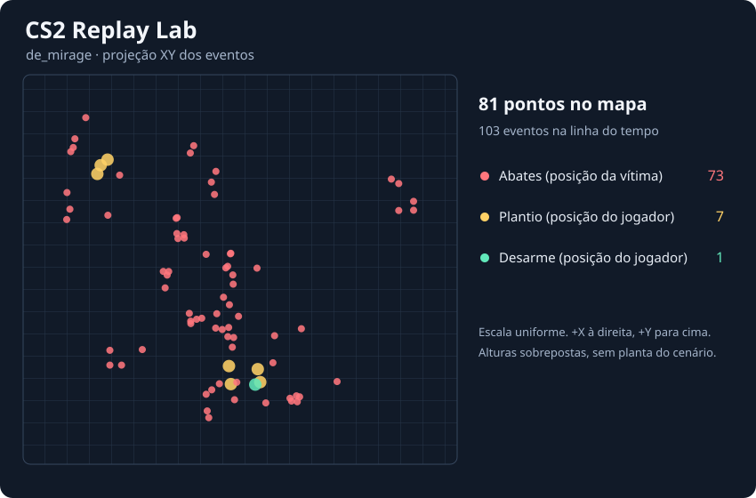

# CS2 Replay Lab

Analisador offline de replays do Counter-Strike 2. Lê um arquivo `.dem` e gera um mapa dos eventos e uma linha do tempo em JSON.



[Mapa SVG](example/map.svg) · [Linha do tempo JSON](example/events.json) · [Replay original de Mirage](https://github.com/LaihoE/demoparser/blob/aafa6079f5c53efa036189b5e6fe0aa350523d87/src/parser/test_demo.dem)

## Reproduzir o exemplo

Use Node.js 22 ou superior.

```sh
npm ci
npm run sample
npm test
npm run analyze -- sample.dem
```

O comando `sample` baixa o replay real de aproximadamente 61 MB do repositório do demoparser, fixado pelo commit acima, e verifica seu SHA-256. O arquivo bruto vem do upstream. Este repositório versiona os relatórios derivados e omite nomes e IDs dos jogadores.

Para analisar outro replay, use `npm run analyze -- partida.dem`. A saída padrão é `reports/map.svg` e `reports/events.json`. Um segundo argumento permite escolher outra pasta.

## Como os campos foram identificados

1. **Assinatura.** Li os oito primeiros bytes da amostra e encontrei `50 42 44 45 4d 53 32 00`, que corresponde a `PBDEMS2` seguido de NUL. O programa verifica essa assinatura antes de chamar o parser.
2. **Nome do mapa.** No offset hexadecimal `0x74` da amostra aparecem `2a 09 64 65 5f 6d 69 72 61 67 65`. O byte `0x2a` é a tag Protobuf do campo 5, do tipo com comprimento. `0x09` indica nove bytes, e eles decodificam para `de_mirage`. Isso bate com `CDemoFileHeader.map_name` no [esquema Protobuf rastreado](https://github.com/SteamTracking/Protobufs/blob/master/csgo/demo.proto) e com a saída de `parseHeader`. O offset é uma observação desta amostra.
3. **Eventos e ticks.** Consultei o [demoparser2](https://github.com/LaihoE/demoparser) para inspecionar os registros de `round_start`, `round_end`, `player_death` e eventos de bomba. O primeiro `player_death` da amostra ocorre no tick **3086**, com `weapon = p250`. A linha do tempo usa o tick fornecido pelo parser e exibe `total_rounds_played + 1` como número do round.
4. **Posição.** Comparei `user_X/Y/Z` com `attacker_X/Y/Z` no mesmo abate. No tick 3086, o X da vítima é aproximadamente **−834,50**, enquanto o X do atacante é **−611,38**. O mapa usa a posição da vítima nos abates e a posição do jogador nos plantios e desarmes. Uma explosão aparece na linha do tempo. A posição de um jogador associada ao evento não identifica o local da explosão.

O projeto verifica a assinatura e documenta os bytes observados no cabeçalho. A decodificação dos pacotes e a reconstrução do estado das entidades ficam a cargo do demoparser2. As coordenadas são propriedades do estado das entidades associadas aos eventos pelo parser.

## Como ler o mapa

O SVG projeta X e Y em escala uniforme, com Y positivo para cima. A grade é esquemática. Ela não reproduz a planta do mapa, e pontos em andares diferentes podem se sobrepor. O JSON preserva Z quando disponível e mantém eventos sem coordenadas na linha do tempo.

O GitHub Actions baixa e valida a amostra, confere os eventos esperados de Mirage e testa a geração dos relatórios.
